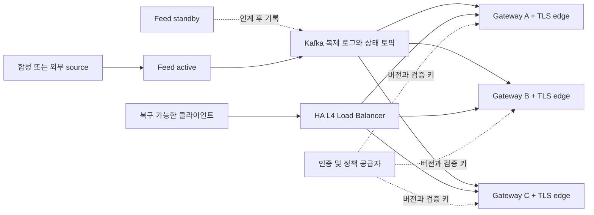
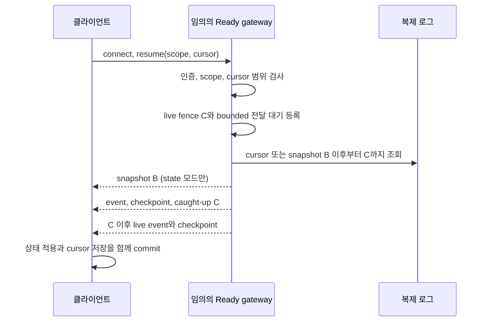

# 고가용성과 재접속 복구 설계

상태: 참조 설계, 미구현. 기준 코드는 `3476d44`다. 현재 서비스가 아래 보장을 제공한다는 뜻은 아니다. [설계 이슈 #45](https://github.com/yceffort/ws-trade-server/issues/45)의 산출물이며 구현 순서와 배포 검증은 [HA 배포 계획](ha-rollout.md)에 둔다. 특정 증권사의 내부 구조를 관측한 결과가 아니라 공개 명세와 현재 코드에서 도출한 실험 설계다.

## 결정과 보장 범위

feed를 gateway Pod에서 분리하고, 복제된 Kafka 로그를 모든 gateway가 독립적으로 읽는다. gateway는 연결과 구독, 최신 상태를 메모리에 보관하지만 로그와 snapshot에서 다시 만들 수 있어야 한다. 기존 mmap 경로는 기본 실험 모드로 유지하고 HA 경로는 별도 입력 어댑터와 배포 구성을 사용한다.

여기서 무중단 배포는 교체 중에도 살아 있는 gateway가 새 접속을 받고, 클라이언트가 재접속해 필요한 데이터를 복구하는 것을 뜻한다. Pod 사이에 기존 TCP/WebSocket 연결을 이동시키지는 않는다. 계획된 교체에서도 개별 소켓은 닫힐 수 있다.

| 범위 | 설계상 보장 |
| --- | --- |
| 기존 `/ws`, `v12.stomp` | 캡처 계약과 연결별 message-id 유지. 재접속 가능하지만 과거 체결 전체의 복구 보장은 없음 |
| 신규 `/experimental/ha/ws`, `wts.ha.v1` | 인증된 재접속, 보관 범위 안의 committed event 재전송, 클라이언트의 중복 제거 |
| 복제 로그 | 단일 broker 또는 단일 장애 도메인 손실 시 commit 완료 데이터의 RPO 0을 검증 목표로 삼음 |
| 외부 source 입력 | 안정적인 event ID와 재전송을 제공하는 source만 무손실 범위에 포함. 외부 제공자가 보내지 않은 데이터는 복구할 수 없음 |
| 서비스 운영 | 단일 gateway, feed, broker 장애에 대응. 전체 region, quorum 다수 및 모든 디스크 동시 손실은 별도 DR 범위 |

네트워크 전송의 exactly-once를 주장하지 않는다. broker commit, gateway의 적용, 소켓 write 완료, 클라이언트의 상태 적용은 서로 다른 시점이다. 마지막 단계의 중복 제거와 cursor 저장까지 갖춘 클라이언트만 재접속 복구 보장을 받는다. [Kafka의 전달 의미](https://kafka.apache.org/41/design/design/) 역시 외부 시스템까지의 보장에는 수신 측 협력이 필요하다고 구분한다.

## 현재 코드의 경계

| 현재 구현 | HA에서 필요한 변화 |
| --- | --- |
| `src/feed.rs`가 프로세스마다 seq와 generator를 새로 만듦 | 재시작 후에도 event ID와 가격, 누적 값이 이어지는 checkpoint |
| `src/bridge.rs`가 로컬 mmap 파일을 읽고 `Read::Lost`를 집계 | 네트워크 로그 입력과 복구 가능한 offset. HA 경로에서 유실 후 조용히 tail로 이동하지 않음 |
| `src/hub/state.rs`가 연결별 큐에 팬아웃 | 모든 gateway에 같은 로그를 공급하고 snapshot, 적용 offset을 함께 관리 |
| `src/hub/cache.rs`가 본문과 로컬 수신 시각만 저장 | 로그 경계를 포함한 복원 가능한 상태. 현재 캐시는 과거 이벤트 재전송 저장소가 아님 |
| `src/server.rs` 종료 시 listener, HTTP, bridge부터 중단 | routing 제거 대기와 기존 연결 처리를 분리하는 drain |
| `examples/reconnect.mjs`가 재구독 후 로컬 snapshot 조회 | 어느 Pod로 가도 유효한 cursor와 snapshot/replay/live 전환 |
| `deploy/k8s`의 feed+gateway+edge, replicas 1, Recreate | producer, 복제 로그, gateway+edge 배포의 독립된 수명 |

## 구성

gateway마다 모든 partition을 명시적으로 assign하고 `read_committed`로 읽는 방식을 기본으로 한다. 자동 consumer group 분배를 쓰지 않는다. 독립 group을 쓰는 대안도 가능하지만 여러 gateway를 같은 group으로 묶으면 이벤트가 나뉘어 다른 Pod의 구독자가 받지 못한다. 로컬 hub의 큐 적재를 Kafka 소비 offset commit이나 클라이언트 ACK로 대신하지 않는다. [Consumer 설정](https://kafka.apache.org/41/configuration/consumer-configs/)의 isolation과 offset reset 의미를 따른다.

HA의 데이터 경로는 broker adapter에서 bounded hub 입력으로 직접 들어간다. 기존 링을 HA의 필수 중간 저장소로 사용하지 않는다. mmap을 다시 최적화 경로에 넣으려면 offset과 `Read::Lost` 복구를 별도로 증명해야 한다.

| 대안 | 판단 |
| --- | --- |
| 기존 링을 RWX volume으로 공유 | 프로세스 간 로컬 mmap의 동기화 가정을 네트워크 파일 시스템으로 확장할 수 없고, 저장 위치만 바꿔 producer와 replay 문제를 해결하지 못함 |
| Redis Pub/Sub | 연결이 끊긴 동안의 replay 요구를 충족하지 못함. [공식 전달 의미](https://redis.io/docs/latest/develop/pubsub/)를 근거로 제외 |
| NATS JetStream | 저장 및 독립 consumer로 구현할 수 있는 대안. 이번 설계에서는 producer fencing과 이벤트/checkpoint 원자 기록을 Kafka transaction에 맞춰 한 방식으로 구체화함. [consumer 문서](https://docs.nats.io/learn/jetstream/pull-consumers) 참조 |
| Kafka | 복제 로그, transaction, producer fencing을 참조 구현으로 채택. 작은 실험에도 운영 자원이 늘어나는 비용을 수용하는 HA 선택 사항 |

## 로그와 event ID

최초 구현은 체결 로그 partition 1개, 기존 두 topic, gateway 3개로 제한한다. 종목별 partition 확장은 처리량을 측정한 다음 버전으로 미룬다. partition 수나 매핑을 바꾸면 새로운 `log_id`로 전환하며 기존 cursor를 그대로 해석하지 않는다.

| 값 | 의미 |
| --- | --- |
| `log_id` | 데이터셋과 partition 배치의 세대. Pod 재시작에는 유지, 데이터셋 초기화에는 변경 |
| `event_id` | `(source_id, source_epoch, source_seq)`에서 결정. 같은 source 이벤트를 다시 보내도 같음 |
| `source_seq` | 합성 source는 checkpoint의 논리 순서, 외부 source는 안정적인 원본 순번. 현재 `Trade.seq`의 프로세스 재시작 값과 구분 |
| broker 위치 | `(log_id, partition, offset)`. 재전송을 시작할 위치이며 event ID와 별개 |
| STOMP `message-id` | 기존 연결 내 전달 순서. 장애 복구 cursor로 사용하지 않음 |

HA envelope는 별도 schema로 만들고 기존 `proto/feed.proto`와 캡처 계약을 유지한다. envelope에 schema version, 위 식별자, source 발생 시각, 수신 시각, 기존 Trade를 담는다. JSON의 64비트 seq와 offset은 십진 문자열로 보낸다. timestamp나 가격, 누적 거래량을 event ID로 대체하지 않는다. 같은 event ID에 다른 payload가 오면 정상 중복으로 숨기지 않고 source 오류로 격리한다.

외부 source 어댑터의 최초 지원 조건은 `(원본 stream ID, 원본 epoch, 단조 증가 원본 순번)`이 재전송에도 유지되는 것이다. 이를 각각 source_id, source_epoch, source_seq로 그대로 매핑하며 event_id는 이 튜플의 모호하지 않은 정규 인코딩으로 정한다. 순번은 topic 필터링 전에 전체 stream에서 비교한다. committed checkpoint에 원본 입력 위치를 저장하고, 같은 stream/epoch에서 그 위치 이하의 재전송은 새 순번이나 ID 없이 버린 뒤 ACK만 재확인한다. 아직 commit되지 않은 입력을 다시 받아도 같은 튜플이 된다. 순서가 뒤바뀐 입력이나 안정적인 순번 없이 opaque ID만 제공하는 source는 첫 구현에서 지원하지 않으며, durable ID 매핑과 중복 판정 범위를 별도로 설계한 뒤 추가한다.

| 토픽 | 내용과 보관 |
| --- | --- |
| `wts.events.v1` | 거래 및 source 상태 레코드, partition 1, `cleanup.policy=delete`, 초기 보관 목표 24시간 |
| `wts.checkpoint.v1` | logical source별 generator 및 입력 위치의 완전한 checkpoint, compact |
| `wts.snapshot.v1` | 허용 topic 전체의 최신 상태와 체결 로그 경계 B를 담은 단일 완전 레코드, compact |

세 토픽과 transaction 내부 토픽은 replication factor 3, min ISR 2를 전제로 한다. producer는 `acks=all`과 idempotence, logical shard에 고정한 `transactional.id`를 사용하고 unclean leader election은 끈다. ISR이 부족하면 성공한 것처럼 응답하지 않고 입력을 중단한다. Kafka 설정의 실제 지원 버전과 Rust client는 구현 단계에서 고정하고 장애 시험으로 확인한다. [Producer 설정](https://kafka.apache.org/41/configuration/producer-configs/)과 [Topic 설정](https://kafka.apache.org/41/configuration/topic-configs/) 참조.

24시간은 용량과 retention 설정이 충족될 때의 목표다. 시간보다 먼저 byte 제한에 걸리거나 운영자가 데이터를 지우면 과거 cursor가 만료된다. consumer의 `auto.offset.reset`은 `none`으로 두고 범위 밖 offset을 자동으로 최신 위치로 바꾸지 않는다. aborted transaction과 제어 레코드 때문에 broker offset에 공백이 생길 수 있으므로 `offset + 1`만으로 체결 유실을 판정하지 않는다.

## feed 인계와 상태 복구

active/standby 2개를 별도 노드에 배치한다. Kubernetes Lease는 인계 시도를 조정하는 용도다. Lease만으로 stale writer를 차단할 수 없다는 것은 [client-go의 leader election 설명](https://github.com/kubernetes/client-go/blob/master/tools/leaderelection/leaderelection.go)에도 명시되어 있다. 쓰기 권한의 마지막 경계는 broker의 transactional producer fencing이다.

1. Lease를 획득한 후보가 shard의 고정 transactional.id로 producer를 초기화해 이전 producer를 fence한다. 초기화 전후에 Lease 소유를 재확인한다.
2. 이전 transaction 정리가 끝난 뒤 `read_committed` checkpoint를 복원한다. 일반 재시작에서는 source epoch, seq, 가격, 누적 수량과 금액, generator 난수 상태 및 symbol 설정을 초기화하지 않는다.
3. 최대 100ms 또는 설정한 batch 상한까지 이벤트를 만들고, 이벤트와 다음 generator checkpoint를 같은 transaction에 기록한다. commit 성공 뒤에만 해당 batch를 완료 처리한다.
4. 10초마다 전체 topic snapshot도 같은 transaction에 넣는다. 이벤트 send 결과의 offset으로 경계 B를 정하고, snapshot 상태는 B까지의 이벤트를 반영한다. 초기화와 거래가 없는 기간에도 유효한 snapshot 및 source 상태를 기록한다.
5. commit 결과가 불명확하면 임의로 새 event ID를 만들어 재전송하지 않는다. 입력을 멈추고 transaction 정리와 committed checkpoint를 기준으로 재시작한다. source가 ACK를 지원하면 broker commit 이후에만 ACK한다.

Lease 갱신 실패, fencing, 권한 오류는 입력 중단과 명시적 종료로 처리한다. fence된 프로세스가 같은 세션에서 producer 초기화를 반복하며 새 leader를 다시 fence하지 않도록 한다. 지연된 옛 후보의 초기화가 새 producer를 방해할 가능성도 있으므로 Lease 재확인만으로 가용성이 증명됐다고 보지 않는다. 긴 프로세스 정지 후 재개와 API/broker 분할 시험에서 committed 순서, 중복, 복구 시간을 모두 검사한다. [Kafka producer API](https://kafka.apache.org/41/javadoc/org/apache/kafka/clients/producer/KafkaProducer.html)의 transaction 복원과 fatal fencing 의미를 따른다.

합성 generator의 checkpoint에는 역직렬화 가능한 내부 정수 상태와 난수 상태가 필요하다. 현재 JSON 본문을 역산해 generator를 복원하지 않는다. 외부 source는 안정적인 ID와 재전송 위치가 있어야 같은 방식으로 적용할 수 있다. 원본이 replay를 제공하지 않으면 leader 교체 동안 수신하지 못한 이벤트는 RPO 0 범위에서 제외한다.

## gateway bootstrap과 snapshot 경계

snapshot은 topic별 compacted 레코드를 임의 시점에 모은 결과가 아니라 전체 map과 B를 가진 하나의 완전 레코드다. topic별 값을 조합하면 서로 다른 시점의 상태가 섞일 수 있다. [Log compaction](https://kafka.apache.org/41/design/design/#log-compaction)은 오래된 값을 제거하므로, 고정 과거 시점의 snapshot 조회 수단으로 취급하지 않는다.

1. gateway는 `BOOTSTRAPPING`으로 시작한다. 검증 가능한 최신 완전 snapshot `(state, B, log_id, schema, config_hash)`를 읽는다.
2. B 이후부터 로그를 읽고 단일 처리 순서에서 cache, hub 입력 및 applied offset을 갱신한다. `hub.publish()`가 채널에 넣었다는 사실만으로 applied offset을 전진시키지 않고 hub 적용 완료 경계를 추가한다.
3. read-committed 경계까지 따라잡고 인증 정책, source 상태와 schema가 유효할 때만 ready가 된다. 미완료 transaction 뒤의 레코드를 먼저 보지 않는다.
4. 복원 도중 B가 retention 밖이 되거나 schema/config가 맞지 않으면 중간 상태를 공개하지 않고 새 snapshot으로 다시 시작한다. 무한 복원 반복은 관측 가능한 실패로 남긴다.

gateway의 cache는 재생성 가능한 최신 상태이며 durable replay 저장소는 broker다. 초기 snapshot 크기는 512KiB, 허용 topic은 최대 256개로 제한해 단일 레코드 복원을 유지한다. 한도를 넘으면 명시적으로 준비 실패로 처리한다. broker에 snapshot을 여러 레코드로 나누거나 외부 object storage를 쓰는 방식은 버전이 있는 manifest와 원자적 공개가 필요한 후속 확장이다. 처음부터 체결이 없는 topic은 명시적인 no-data 상태로 표현하며 가짜 체결을 만들지 않는다.

거래가 없는 topic도 마지막 상태와 그 상태의 event 위치를 보존한다. source는 최소 1초마다 연결 상태와 시장 상태를 별도 레코드로 보낸다. readiness는 마지막 거래 시각이 아니라 bootstrap 완료, 로그 지연, source heartbeat와 정책 신선도로 판단한다. 합성 feed의 현재 10초 snapshot probe를 그대로 운영 HA probe로 사용하지 않는다. HA snapshot과 source-status에는 마지막 상태의 기준 시각 및 source 상태를 포함한다. source/broker 신선도 상한을 넘기면 기존 HA 연결에도 source-stale 오류를 알리고 닫아, 서버 heartbeat만 살아 있는 것을 정상 체결 공급으로 오해하지 않게 한다.

## 재접속 계약

기존 `/ws`는 수정하지 않는다. `/experimental/ha/ws`의 `wts.ha.v1`은 다음 제어 프레임을 사용하는 별도 JSON 프로토콜이다. 아래 이름은 신규 설계이며 관측한 증권사 프로토콜이 아니다. TLS 연결 후 첫 `connect` 프레임에서 인증하고 성공 전에는 snapshot이나 replay를 제공하지 않는다. 현재 edge는 `/ws`와 `v12.stomp`만 허용하므로 새 경로와 subprotocol을 명시적 allowlist에 추가하고 선택한 값을 upstream까지 보존해야 한다. 기존 경로의 규칙을 느슨하게 만들지 않는다.

| 프레임 | 의미 |
| --- | --- |
| `connect`, `connected` | 토큰 검증과 세션 수립. 이후 모든 요청에서 허용 topic scope 유지 |
| `resume` | request ID, 정렬한 topic 집합, `state` 또는 `events` 모드, 선택적 cursor 또는 `start_at` |
| `snapshot-begin`, `snapshot-chunk`, `snapshot-end` | 요청한 topic의 상태와 경계 B를 bounded 조각으로 전달. `state` 모드에서만 허용 |
| `event` | event ID, topic, broker 위치, 기존 JSON 본문 |
| `checkpoint` | 이 프레임 이전에 해당 구독으로 전달한 이벤트를 모두 적용하면 저장할 수 있는 서명 cursor |
| `caught-up`, `source-status`, `draining`, `error` | 복구 완료, source 상태, 재접속 유도, 범위/권한/자원 오류 |

cursor는 version, log_id, partition 위치, topic 집합과 인증 scope의 hash, 발급 시각을 포함해 서명한다. 어느 gateway에서도 검증할 수 있어야 하고 서명 키는 보관 기간 동안 검증 가능해야 한다. 서명 cursor 자체가 접근 권한은 아니며 매번 현재 인증과 권한을 검사한다. scope나 log_id가 달라지면 기존 cursor를 거절한다. 최초 버전은 연결마다 하나의 고정 topic 집합을 사용하며 topic 변경은 새 연결에서 시작한다. 다른 topic을 추가하면서 이전 scope의 cursor를 그대로 적용하지 않는다.

유효한 cursor가 해당 gateway의 적용 위치보다 앞서 있으면 제한된 시간 안에 catch-up을 기다리고, 실패하면 retry-later로 응답한다. 더 낮은 위치에서 성공한 것으로 응답하지 않는다. gateway는 replay 시작 전에 같은 hub 직렬 처리 경계에서 C를 잡고 C 이후 live 데이터를 bounded 대기에 등록한다. snapshot 모드라면 같은 경계에서 `state(C)`를 복사해 C를 B로 사용할 수 있다. 먼저 snapshot을 복사하고 나중에 구독을 등록하는 틈을 만들지 않는다. 오래된 durable snapshot B를 쓴 경우에는 `(B,C]`도 재생한다. replay가 끝나기 전에는 C 이후 이벤트가 앞서 나가지 않으며 대기열 초과 시 checkpoint를 건너뛰지 않고 재접속 가능한 오류로 종료한다.

broker의 원자적 snapshot 레코드와 WebSocket 전송 단위를 구분한다. edge의 기존 64KiB 메시지 상한을 지키도록 snapshot은 최대 32KiB의 원본 bytes를 base64로 나누며 직렬화된 프레임 전체를 48KiB 이하로 제한한다. 모든 조각에 같은 snapshot ID와 B를 사용하고 총 bytes, 조각 수, SHA-256을 snapshot-end에서 확인한다. 클라이언트는 최대 512KiB까지 조립하고 전체 검증이 끝나기 전에는 상태나 cursor를 적용하지 않는다. 중간 단절과 timeout은 이전 적용 cursor부터 다시 시작한다. replay와 live event는 snapshot-end 뒤에 보낸다.

클라이언트는 event ID로 중복을 제거하고 상태와 마지막 적용 cursor를 같은 로컬 transaction으로 저장한다. 수신 콜백 진입이나 소켓 write 완료 시점의 cursor를 저장하지 않는다. 앞선 해당 구독 이벤트를 다 적용한 뒤 checkpoint를 저장하면 구독하지 않은 topic 및 Kafka 제어 레코드의 위치도 안전하게 넘길 수 있다. 서버는 WebSocket이 끊긴 뒤 클라이언트가 어디까지 적용했는지 추측하지 않는다.

`events` 모드에서 cursor가 없으면 `start_at: {log_id, partition, offset}`을 요구한다. offset은 십진 문자열이며 해당 위치를 포함해 첫 read-committed 이벤트부터 보낸다. cursor는 이미 적용한 경계를 뜻하므로 그 위치를 제외하고 재개한다. 두 필드를 함께 보내거나 events 모드에서 둘 다 생략하면 invalid-resume으로 거절한다. start_at은 서명 없는 시작 요청일 뿐 접근 권한이 아니며 현재 scope, log_id, partition 및 보관 범위를 검증한다. 보관 시작 이전이나 현재 읽기 경계보다 미래인 위치는 start-out-of-range로 거절하고, aborted transaction이나 제어 레코드 위치는 다음 보이는 이벤트부터 읽는다. cursor가 만료되면 `cursor-expired`와 현재 복구 가능 범위를 알려 주며 snapshot으로 조용히 대체하지 않는다. 최신 화면 상태만 필요한 클라이언트는 별도로 `state` 모드를 선택해 snapshot부터 시작할 수 있다. state 모드는 start_at을 허용하지 않으며 유효한 cursor가 있으면 이어서 복구하고, cursor가 없을 때만 새 snapshot을 요청한 것으로 본다. 가짜 새 데이터로 retention 공백을 채우지 않는다.

대기 요청은 worker가 허용되기 전 live buffer를 만들지 않는다. 초기 제한은 Pod당 replay worker 32개, 대기 요청 128개, 세션당 live 대기 1MiB, 요청당 replay 10,000건/10MiB/10초다. 초과 시 `replay-limit` 또는 `retry-later`로 종료하고 이미 적용한 cursor에서 다시 요청하게 한다. 제한값은 부하 시험에서 조정하되 무제한 consumer, 태스크와 큐를 만들지 않는다. 신규 HA 클라이언트의 초기 heartbeat 주기는 1초, 수신 deadline은 3초, 첫 재접속 jitter는 최대 500ms로 두고 이후 실패에 지수 지연을 적용한다. 이 값과 TLS 연결 및 replay 시간을 합쳐 실제 복구 목표를 검증한다. 기존 예제의 재시도 설정을 그대로 쓰고 5초 목표를 달성했다고 주장하지 않는다.

## 장애별 처리

| 상황 | 처리 |
| --- | --- |
| gateway Pod 종료 또는 손실 | 다른 gateway로 재접속, 보관 범위 안 cursor에서 replay. 연결 상태 자체는 복제하지 않음 |
| feed active 손실 | standby가 fence 후 committed generator checkpoint에서 재개. 미확정 batch는 복원 절차로 판정 |
| broker 1개 손실 | 남은 ISR/quorum으로 계속 처리하는지 검증. 재선출 중 일시 지연은 허용 |
| quorum 또는 ISR 부족 | producer commit 중단, gateway freshness 저하 표시와 ready 해제. 오래된 데이터를 정상 실시간 데이터로 표시하지 않음 |
| source 휴장 | 정상 heartbeat와 시장 상태가 있으면 거래가 없다는 이유만으로 실패하지 않음 |
| 느린 클라이언트 | 해당 연결만 bounded 정책으로 끊고 cursor 재접속. 전체 로그 소비를 한 소켓에 묶지 않음 |
| 모든 gateway 재기동 | durable snapshot과 로그로 bootstrap. readiness 이전의 빈 캐시를 공개하지 않음 |
| retention 또는 dataset 교체 | 명시적 복구 불가. 사용자가 state 재설정 또는 외부 이력 복원을 선택 |

## 비용과 다음 단계

첫 수용 시험은 클라이언트 1,000개, 기존 두 topic 각각 초당 50건으로 고정한다. gateway 1개가 없어도 남은 2개가 이 부하와 재접속 폭주를 처리해야 한다. 아직 측정 결과는 없으며 기존 단일 프로세스 benchmark를 이 구조의 수치로 인용하지 않는다.

이벤트 평균 1KiB, 초당 100건, 24시간, 복제 3이면 원본 로그만 약 26.5GB가 필요하다. checkpoint, snapshot, Kafka segment, compaction 여유와 파일 시스템 공간은 별도다. gateway 3개가 전체 로그를 읽으므로 broker의 소비 전송량도 대략 3배이며, 클라이언트 팬아웃 비용은 별도로 증가한다. transaction batch는 지연을 더하므로 기존 mmap 지연 목표와 동일하게 보지 않는다.

운영에는 장애 도메인에 분산한 broker 3개와 controller quorum, persistent volume, HA 네트워크 및 인증 공급자가 필요하다. gateway의 엄격한 zone/hostname 분산과 순차 교체에는 [배포 계획](ha-rollout.md)에 명시한 zone당 적격 노드 2개, 총 6개와 surge 용량도 필요하다. 운영용 controller/broker 역할과 배치는 [KRaft 문서](https://kafka.apache.org/41/operations/kraft/)를 따라 별도 결정한다. 한 호스트 kind의 통합 역할 구성은 기능 시험용이다. 이 비용이 과하면 현재 단일 Pod 구성을 유지하거나 JetStream 대안으로 별도 ADR을 쓰고 동일한 복구 및 fencing 시험을 통과시킨다.
